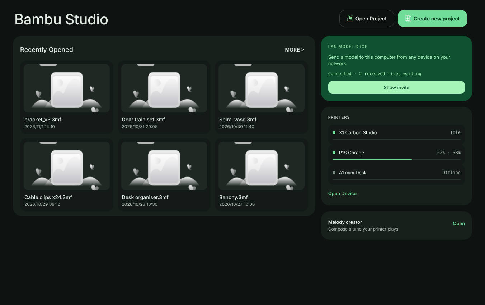
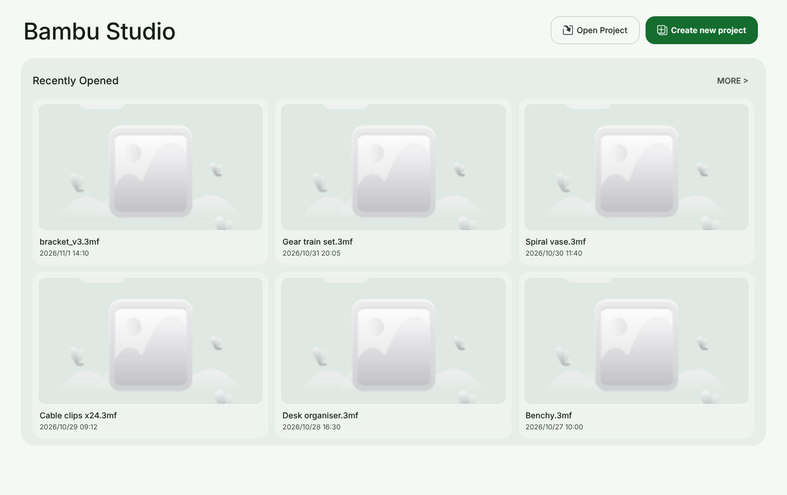
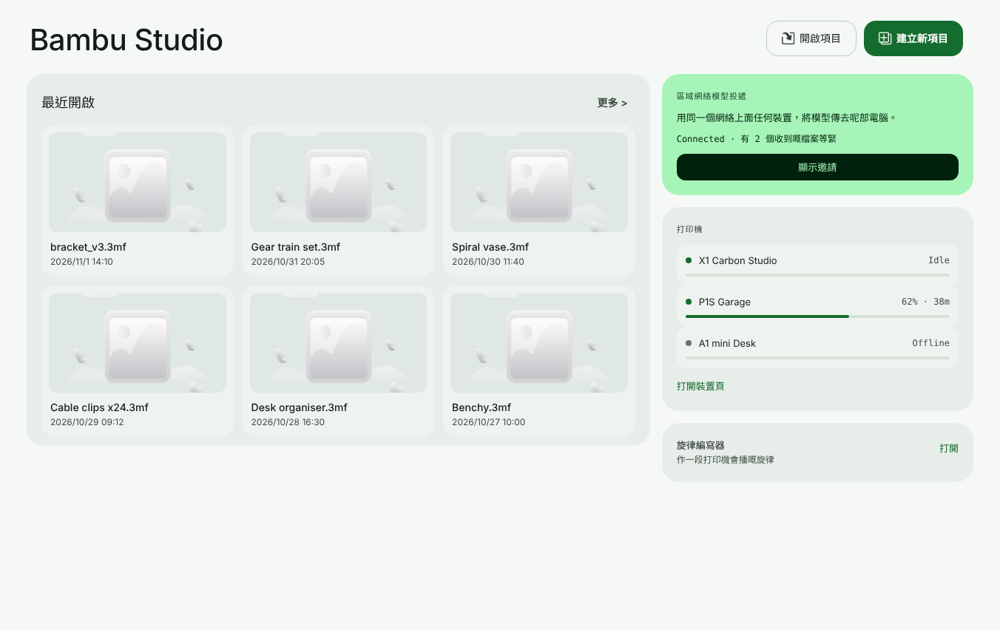

# Graphite shell

The Graphite shell is a redesign of the main window chrome. It changes where the workspaces live and the neutral palette every Material Design 3 surface paints from. Slicing, printing, presets, projects and every feature of this fork are unchanged.

## What changed

- **Navigation rail.** The main workspace book (`MainFrame::m_tabpanel`) docks left with `wxNB_LEFT`. `ButtonsListCtrl` lays its destinations out as an 88 px rail: each destination is a 72 x 60 px tile with the Material Symbols glyph above the label, the selected tile takes the secondary container, and a short primary bar on the leading edge is the non-colour cue. Navigation actions (Settings) are pinned to the bottom. When the window is too short, the overflow menu takes the tail exactly as the strip did, measured along the height with the same `NotebookNavigation::fit()`.
- **Every other notebook keeps the top strip.** A notebook created without a dock style still defaults to `wxBK_TOP`, so the settings dialog and its sub-tabs are untouched.
- **Graphite palette.** The neutral ramp in `MD3Tokens.hpp` becomes a green-tinted graphite. Dark: ground `#0e1311`, containers `#0a0e0c` to `#28322c`, text `#e3ebe5` and `#a9b6ad`, primary `#6fdc98`. Light: ground `#f5f8f5`, containers `#ffffff` to `#d6e1da`, text `#131c17` and `#3f4c44`, primary `#146c2e`. Text keeps at least 4.5:1 and outlines at least 3:1 against every surface in both themes, and the dark compatibility map stays idempotent (`tests/native_navigation/neutral_palette.test.mjs`).
- **Floating canvas.** The 3D canvas (Prepare, Preview and Assemble) sits on the window ground with a gutter of one density gap on every side, and the hairline between the sidebar and the canvas is gone. The canvas corners stay square because the OpenGL view is a native child window.
- **Floating sidebar cards.** The Prepare sidebar sections (printer, filament, process, object list and object manipulation) are now rounded cards on the window ground instead of bands from edge to edge. Each card is SurfaceContainerLow with a 1 px OutlineVariant edge and the 24 px panel radius, with 8 px of padding around the section and half a density gap to the sidebar edge. Only the cards of the active section tab are drawn, and the divider between the printer and filament sections is gone. The sections keep their own controls and colours.
- **Floating Preview legend.** The legend dock on the right of Preview now sits half a density gap in from the top and right edges of the canvas with rounded corners, instead of running from edge to edge. The corner uses the small radius, so the dock's content, which keeps 4 px from its edge, never crosses it. The inset counts as dock width, so the layer slider, the move slider and the notifications still keep clear of it.
- **Command palette.** The palette is one SurfaceContainerHigh surface: its list and rows no longer sit on separate lighter or darker panels, and the selected row takes the secondary container with its matching text and icon colour. Every other dialog already uses the 28 px dialog radius and 24 px padding the design asks for.
- **Language switch in the title bar.** A three-segment switch (EN, 粵, 雙) sits before the window controls and shows the current language mode. Choosing another segment runs the same steps as Preferences: an offer to save an unsaved project, the restart confirmation, the modified-preset check, then the interface is rebuilt in the new mode. Any other installed language leaves no segment highlighted.
- **Search field in the title bar.** A rounded field reading "Search commands and settings" with the search symbol and the palette shortcut on a key cap sits right of the menus. Clicking it opens the command palette, which searches every menu command, workspace, Preferences setting and documentation article. On a title bar narrower than 1180 px the field is hidden before the project name shrinks, so the window controls never move into the overflow.
- **Update chip in the title bar.** When a background update has been downloaded and is waiting, a "Restart to update" pill in the primary container colour appears after the language switch. Clicking it restarts into the new version through the same path as the notification's restart link. Its tooltip says the update is not code-signed. The chip stays hidden at all other times, and the notification still appears as before.
- **Floating Prepare actions.** The plate chips, the estimate and the Slice and Print buttons under the Prepare canvas sit on the window ground instead of a separate band, and the hairline above them is gone. The controls, their order and their behaviour are unchanged.
- **Web pages follow the palette.** Every bundled web page that carries its own copy of the colour roles (Home, the device page, the filament manager and creator, the guide, login and the model pages) now uses the Graphite values, so web surfaces match the native ones.
- **Home.** The Home page drops the gradient hero band for a plain display header with 16 px action buttons, and shows up to six recent projects as a three-column grid inside one 24 px panel. A column beside the panel (below it on windows narrower than 1088 px) holds three cards. The LAN model drop card shows the link state and the number of received files waiting, opens the invite dialog with Show invite, and offers Open settings while the feature is off. The printers card lists up to four of your printers with a state dot, the state, the progress and the time left, and links to the Device page. The melody creator card opens the melody creator. The page asks the application for this state when it opens and every five seconds while it is visible; printer names are inserted as text, never as markup. These renders come from the shipped page opened in Chromium with sample recent files and sample printers, not from the running application:

  
  
  
- **New tokens.** `navigation_rail_width`, `navigation_rail_item_width`, `navigation_rail_item_height` and `radius_panel` (24 px, for floating panels and the canvas frame).

## Verification

- `g++ -fsyntax-only` against wxWidgets 3.2, Boost and OpenCASCADE headers on Linux passes for `Notebook.cpp` and `MainFrame.cpp`.
- `tests/native_navigation/graphite_rail.test.mjs` pins the left dock, the top-strip default for other notebooks, the rail geometry and the Graphite grounds.
- `tests/native_navigation/graphite_command_palette.test.mjs` pins the palette surface and selection roles.
- `tests/native_navigation/graphite_preview_dock.test.mjs` pins the legend dock inset, its rounding and the corner cut at both densities.
- `tests/native_navigation/graphite_sidebar_cards.test.mjs` pins the card padding against the corner radius, the one-time setup after every section is added, the layout on each section change and the colour roles.
- `tests/native_navigation/graphite_home_column.test.mjs` pins the Home column markup, its commands on both sides of the bridge, the text-only insertion of printer names and the strings in both languages.
- `tests/native_navigation/graphite_title_bar.test.mjs` pins the language switch modes, the order of the title bar items, the hidden-until-ready update chip and its restart action, and the search field: its place, the palette it opens, its narrow-bar hiding and its colour roles.
- `tests/native_navigation/graphite_action_bar.test.mjs` pins the ground colour of the Prepare actions and the hidden hairline.
- The hosted Windows build compiled the rail, the palette, the floating canvas, the language switch, the update chip, the sidebar cards, the Home column and the Preview legend.
- The node contract suite reports the same failures as `main` and no new ones. The fingerprint of `MainFrame::init_tabpanel` in `tests/native_shared_controls/atlas_shell_preserved_functions.json` was refreshed because this change deliberately edits that function.

Not verified yet: the hosted Windows build of the command palette, the title bar search field and the floating Prepare actions, the running application, captures in English, Cantonese and bilingual modes at each scale, and the keyboard order through the rail.

## Next steps

The design also rounds the canvas frame, rearranges the Preview controls (view chips, layer slider and the bottom bar) and restyles Device and the Send print and Melody creator dialogs. Those are not implemented yet. The full design is in `design/graphite-shell/`. The feature inventory that keeps the redesign from dropping any feature is `design/graphite-shell/FEATURE_PARITY.md`, and the motion specification is the Graphite shell section of `design/interface-motion.md`.
