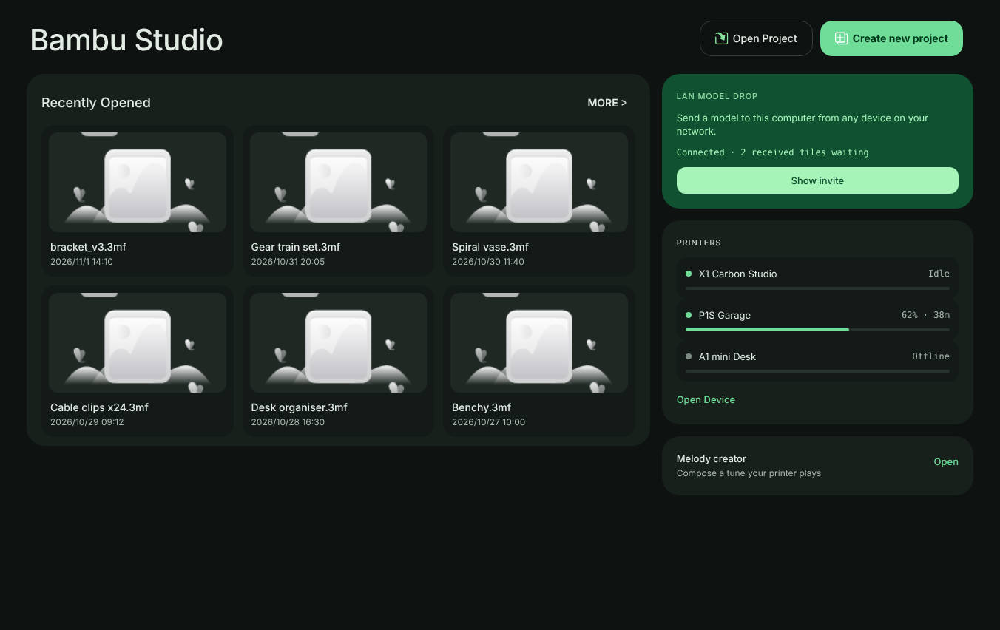
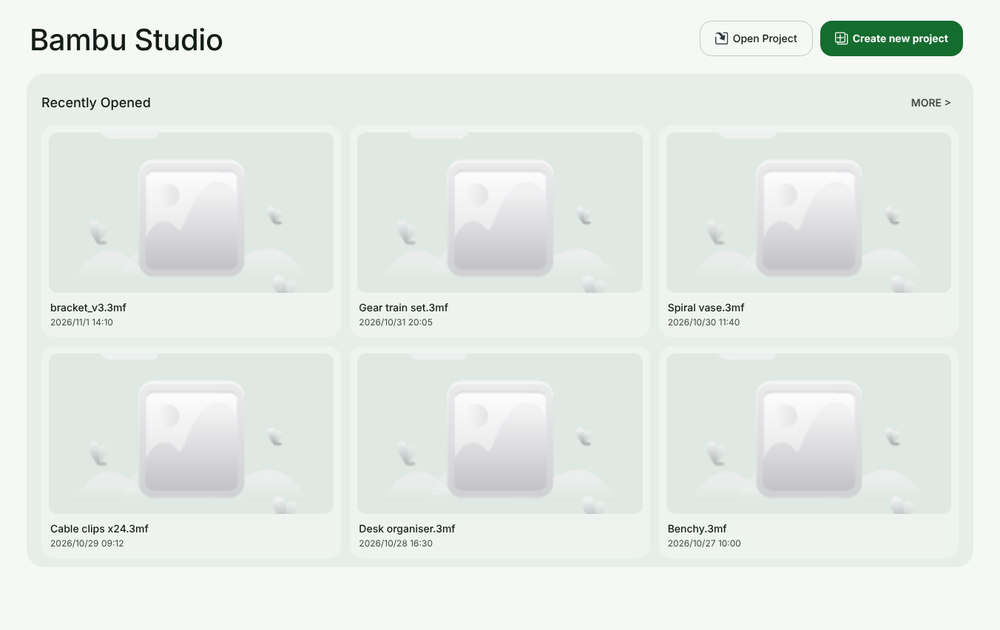

# 石墨外殼

石墨外殼係主視窗外框嘅重新設計。佢改咗工作區擺放嘅位置，同埋所有 Material Design 3 表面用嚟上色嘅中性色盤。切片、打印、預設、專案同呢個分支嘅所有功能都冇改。

## 改咗乜

- **導航欄。** 主工作區（`MainFrame::m_tabpanel`）用 `wxNB_LEFT` 靠左擺。`ButtonsListCtrl` 將各個目的地排成 88 px 闊嘅直欄：每個目的地係 72 x 60 px 嘅方塊，Material Symbols 圖示喺標籤上面；揀咗嘅方塊用次要容器色，前緣有一條短嘅主色條，唔使靠顏色都認得出。導航動作（設定）固定喺最底。視窗太矮嗰陣，尾段會好似以前橫條咁收入溢出選單，用同一個 `NotebookNavigation::fit()`，不過係量高度。
- **其他分頁簿保持頂部橫條。** 冇指定停靠方向嘅分頁簿仍然預設 `wxBK_TOP`，所以設定對話框同佢嘅子分頁冇郁過。
- **石墨色盤。** `MD3Tokens.hpp` 入面嘅中性色階變成帶少少綠嘅石墨色。深色：底色 `#0e1311`，容器由 `#0a0e0c` 到 `#28322c`，文字 `#e3ebe5` 同 `#a9b6ad`，主色 `#6fdc98`。淺色：底色 `#f5f8f5`，容器由 `#ffffff` 到 `#d6e1da`，文字 `#131c17` 同 `#3f4c44`，主色 `#146c2e`。兩個主題入面，文字對每個表面都有至少 4.5:1 對比，外框至少 3:1，深色兼容對照表仍然係冪等（`tests/native_navigation/neutral_palette.test.mjs`）。
- **浮動畫布。** 3D 畫布（準備、預覽同組裝）而家喺視窗底色上面，四邊各留一個密度間距，側欄同畫布之間嗰條細線拎走咗。因為 OpenGL 視圖係原生子視窗，畫布角仍然係直角。
- **網頁跟住色盤。** 每個自帶一份顏色角色嘅內置網頁（主頁、裝置頁、耗材管理同建立、指南、登入同模型頁）而家都用石墨數值，網頁表面同原生表面睇落一致。
- **主頁。** 主頁唔再用漸變橫幅，改為放喺底色上面嘅大標題，配 16 px 圓角按鈕；最近專案喺一個 24 px 面板入面排成三欄，最多六個。以下截圖係用 Chromium 打開隨附嘅網頁再填入示範最近檔案，唔係由運行中嘅應用程式截取：

  
  
- **新設計記號。** `navigation_rail_width`、`navigation_rail_item_width`、`navigation_rail_item_height` 同 `radius_panel`（24 px，用喺浮動面板同 3D 畫布外框）。

## 驗證

- 喺 Linux 用 wxWidgets 3.2、Boost 同 OpenCASCADE 標頭做 `g++ -fsyntax-only`，`Notebook.cpp` 同 `MainFrame.cpp` 都通過。
- `tests/native_navigation/graphite_rail.test.mjs` 鎖定靠左停靠、其他分頁簿預設頂部橫條、導航欄尺寸同石墨底色。
- node 合約測試套件嘅失敗同 `main` 一樣，冇新增。`tests/native_shared_controls/atlas_shell_preserved_functions.json` 入面 `MainFrame::init_tabpanel` 嘅指紋已經更新，因為今次改動係刻意改嗰個函數。

未驗證：Windows 託管建置、實際運行嘅應用程式、英文、廣東話同雙語模式喺各個縮放比例嘅截圖，同埋喺導航欄入面用鍵盤移動嘅次序。

## 下一步

設計仲將側欄各部分變成浮喺底色上面嘅 24 px 面板，同埋將畫布外框改成圓角，將語言切換同更新通知搬入標題列，喺主頁加打印機同區域網絡模型投遞一欄，同埋重新設計預覽、裝置同各個對話框。呢啲仲未做。完整設計喺 `design/graphite-shell/`。
