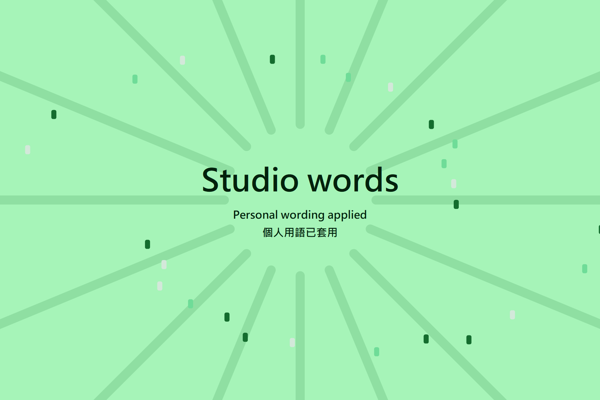
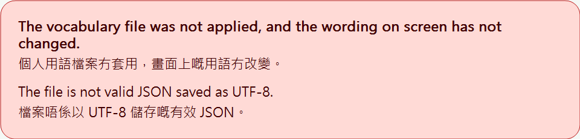

# Personal vocabulary

Preferences > Appearance > Personal vocabulary loads a local version 1 JSON file.
The same control replaces a loaded file. Clear personal vocabulary restores the
original wording without restarting. Invalid input preserves the active mapping.

```json
{"schemaVersion": 1, "entries": {"Open": "Inspect"}}
```

## Dropping a file on the window

Dropping one `.json` file anywhere on the main window applies it at once, with no
restart. A drop goes through the same validation as the Settings control, which
stays available as the other route in. Model and G-code drops are unchanged: only
a drop of exactly one `.json` file is read as a vocabulary file.

- A valid file plays the Windows "tada" sound once and shows a celebration over
  the window for about three seconds. Its headline is the wording the dropped file
  gives for `private vocabulary`, read when the file is applied; a file without
  that entry shows "Personal wording applied". The rest of the file applies to the
  interface straight away.
- A rejected file plays the Windows error sound once and shows a notice near the
  bottom of the window for five seconds, naming the rule the file broke. Nothing is
  saved and the wording on screen does not change.
- The celebration and the notice never take focus or input: clicks pass through
  them to the workspace. With Windows animation effects turned off they appear and
  disappear without the fade and the rising headline.
- Both outcomes are announced to screen readers through UI Automation.
- Sounds follow the system volume and mute, and are skipped while Windows reports
  quiet hours, a full-screen app or presentation mode. The notice and the
  announcement still appear.
- The text follows the current language mode; the bilingual mode shows both
  languages. Only the headline comes from the file, and the log records only
  whether a drop was applied and the number of the rule it broke.

Panels that display web content (Home, the device page) handle drops themselves;
a file dropped on them may not reach the window's drop target.

| Applied | Refused |
| --- | --- |
|  |  |

The captures use a made-up sample file, not a real personal vocabulary; see
[their provenance](../../screenshots/vocabulary-drop/README.md).

## File format and limits

The file is one JSON object with exactly two fields: `schemaVersion`, which must
be the integer `1`, and `entries`, an object that maps original interface
wording to replacement wording. An empty `entries` object is valid.

| Rule | Limit |
| --- | --- |
| File size | 256 KiB (262,144 bytes) of UTF-8, whitespace included. A UTF-8 byte order mark is accepted only at the start. |
| Nesting depth | 8 levels of objects and arrays. A version 1 file uses 2 levels; anything nested under an entry is a non-string value. The parser stops at level 9. |
| Key length | 1 to 160 Unicode code points. |
| Value length | 1 to 1,000 Unicode code points. |
| Number of entries | No fixed count. Every valid entry is accepted, so only the file size limits how many entries fit. |

Lengths count Unicode code points, not UTF-8 bytes or UTF-16 units. A character
outside the Basic Multilingual Plane, such as an emoji, counts once even though
it takes four UTF-8 bytes, a JSON surrogate-pair escape, or two UTF-16 units.

The loader also rejects:

- malformed JSON: an empty file, a syntax error, comments, trailing content,
  invalid UTF-8, or an unpaired surrogate escape;
- a key repeated in any object, compared after escapes are decoded;
- a missing `schemaVersion`, or any value other than the integer `1`
  (`2`, `1.0` and `"1"` are all rejected);
- any root field other than the two above, or `entries` that is not an object;
- an entry value that is not a string;
- blank text (empty or only Unicode white space), C0 and C1 control
  characters, DEL, the directional embedding, override and isolate characters
  U+202A to U+202E and U+2066 to U+2069, and the exact names `__proto__`,
  `constructor` and `prototype`, in keys and values alike.

Validation covers the whole file before anything is shown or saved. Structural
problems (size, malformed JSON, depth and repeated keys) are found first, then
the version, then the fields and entries. One failed rule rejects the whole
file: nothing from it applies, and the wording on screen stays as it was. The
settings control then names the rule that failed, for example that the file is
larger than 256 KiB or that an entry value is longer than 1,000 characters. It
never shows the file name, a key or a value.

## Display

Only translated interface copy registered by the localization boundary is eligible.
The final shared label, button, native-menu and combo-popup display adapters apply
the mapping; editable input and source model values are never rewritten. URLs,
paths and format templates retain their original text. Preferences search reads
original unwrapped labels. The canvas display adapter uses the same interface.

Matching first prefers exact spelling, longest source first, at word boundaries,
and is nonrecursive. If no exact source matches, ASCII letters are compared
without case, still longest first. Replacement spelling stays exactly as supplied.
If equally long case variants disagree on their replacement, the source stays
unchanged. Non-ASCII characters remain exact. Display indexes candidates by their
ASCII-folded first character rather than scanning the entire mapping per position.
Shared canvas text, titles, buttons, checkboxes, radio buttons and tooltips, plus
shared bilingual tab and field painting, resolve wording at the display boundary.
Canvas control identities remain bound to the original text across load and clear.
Existing explicit `###` identities retain their hash. Plain and `##` labels move
once to a new original-derived hash when this implementation is installed, then
remain stable for subsequent load, replacement and clear. Studio disables ImGui
INI persistence (`IniFilename = nullptr`), so this does not migrate a saved window
layout. This is not proof of packaged runtime interaction.
Menu normalization propagates eligibility only from an already registered raw
label or its exact pre-shortcut portion. Removing mnemonic marks never grants
eligibility to a dynamic menu name.
Explicit composition can join registered translated fragments with a short
structural separator; it never registers unknown fragments or dynamic arguments.
The registry of eligible interface copy keeps the first 50,000 distinct strings
translated in a session; copy translated after that keeps its original wording.

## Saved copy

Persistence uses the operating system's local application-data directory under
`private-display/vocabulary.json`, outside synchronized preferences. The `--datadir` option does not isolate this
wxWidgets application-data location; probes use their own application name. Replacement
uses a unique, exclusively created sibling temporary file for each operation and
an atomic Windows rename. Concurrent writers cannot rename each other's pending
contents, and clear never deletes another operation's pending file. The selected input
path is not retained. No payload, mapped value or selected filename is logged or
sent over the network. Profile archives exclude the private cache, including when
a custom data folder encloses it. Shared labels retain original native text and all original getter values, applying
replacement only while painting and measuring. Buttons and menu models also retain
their original values. Logging, action comparisons and layout receipts therefore
continue receiving the original text.

At startup the saved copy is checked with exactly the rules above before it is
used. A missing copy means original wording. A copy that cannot be read, is
over the size limit, was saved under earlier and wider limits, or is otherwise
invalid is not used: original wording shows, and the settings control says the
saved vocabulary did not pass validation and which rule failed. Clear personal
vocabulary deletes it. If the private copy cannot be written, a valid file is
not applied either, and the control says so.

## Verification

The file rules have a test that needs neither wxWidgets nor Catch2. From the
repository root:

```sh
g++ -std=c++17 -Wall -Wextra -Werror -Isrc \
    tests/personal_vocabulary/personal_vocabulary_schema_test.cpp \
    src/slic3r/GUI/PersonalVocabularySchema.cpp -o personal_vocabulary_schema_test
./personal_vocabulary_schema_test
```

It checks each limit at exactly the limit and one over: the file size in bytes,
the nesting depth, and key and value lengths in ASCII, two-, three- and
four-byte characters and surrogate-pair escapes. It also accepts files with
2,049, 5,000 and 20,000 entries, rejects every rule above, and confirms a
rejected file leaves the previous result unchanged. CMake builds it as
`personal_vocabulary_schema_test`. The `personal-vocabulary-limits` source
contract under `ui-md3/tests` fails if a fixed entry count returns to the
loader, its tests or this article.

On a configured hosted Windows build, build `personal_vocabulary_tests`,
`personal_vocabulary_schema_test` and `personal_vocabulary_probe`, then run
the tests and the probe phases in order: `load-first`, `restore-first`,
`invalid`, `replace`, `restore-second`, `clear`, `restore-empty`, `large`,
`restore-large`, `stale-cache`, `restore-stale`, `corrupt-cache`,
`restore-corrupt`, `clear`, `restore-empty`. The additional `composition` phase checks registered fragments, unknown input,
School-mode suppression and clear. Each probe invocation must be a fresh process. The probe uses only synthetic neutral text in an isolated
application-data namespace, turns School mode suppression off because it has
no School mode record, and emits only a pass/fail result. Also run `race-a` and
`race-b` concurrently as separate processes, wait for both, then run
`verify-race` and `clear`.

These tests and every probe phase, including the concurrent writers, also build
and pass on Linux against wxWidgets 3.2. That run is not Windows evidence.

The native UI still requires hosted interaction evidence for load, applied wording,
restart, replace, clear and invalid input, plus original wording in exports/logs.
Exercise normal/minimum sizes, English/Cantonese/bilingual modes, light/dark and
100/125/150/200 percent scaling. The owner's private JSON must not be copied into
public hosted inputs, logs or captures; its private end-to-end verification is
separate and remains unavailable in that environment. Source coverage does not
claim all custom-drawn surfaces are verified.

The `personal_vocabulary_native_contract` source check rejects writes of mapped
text to native label storage and exercises the reviewed bad-setter mutation.
It is not a substitute for native interaction: with a synthetic mapping loaded,
verify `Label::GetLabel()`, `GetLabelText()`, and `GetUnwrappedLabel()` retain their
original values before and after painting, replacement and clear. Check the
calibration title log, nozzle-rack action comparisons and layout receipt labels
against those originals in the hosted application.

## Alternate profile isolation

The normal profile keeps its existing user-local wording cache. An alternate
`--datadir` or portable profile stores wording in its own `private-display`
directory. Startup binds that location before loading any wording; an empty,
invalid or unwritable alternate cache never falls back to the normal profile.
An explicit path equivalent to the default data directory keeps the existing
normal-profile cache. No cache is migrated or copied automatically.

Profile exports and snapshots omit the reserved directory even for inactive
profiles. Profile archive import rejects reserved cache entries, so importing
settings does not implicitly import personal wording. Use the local wording
upload or drop control separately.

`node tests/personal_vocabulary/cache_isolation.test.mjs` executes production
cache-selection, initialization and persistence functions against neutral
filesystem fixtures with parser and repaint doubles. Its `--mutant=shared-cache`
variant must fail. This is bounded behavioral evidence, not a built-interface
or real JSON-parser acceptance result.
