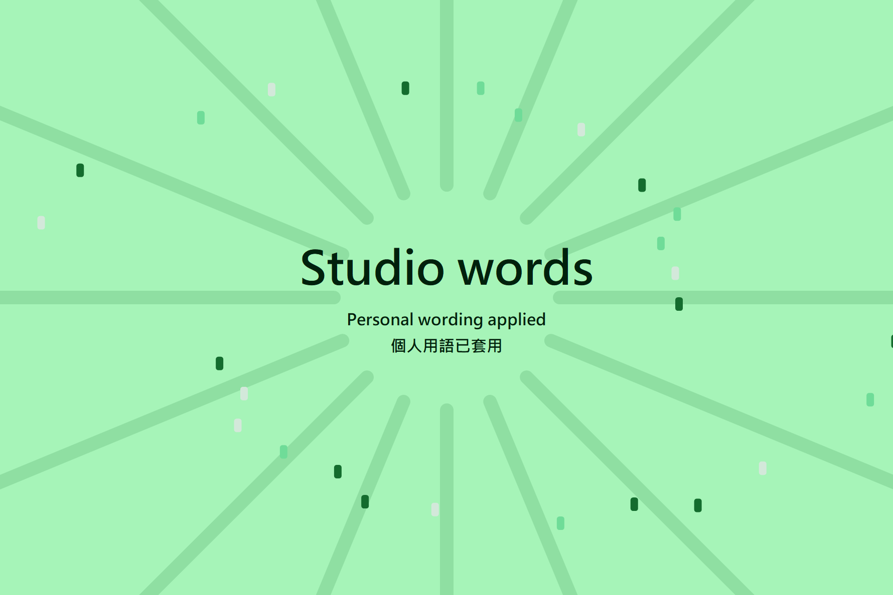
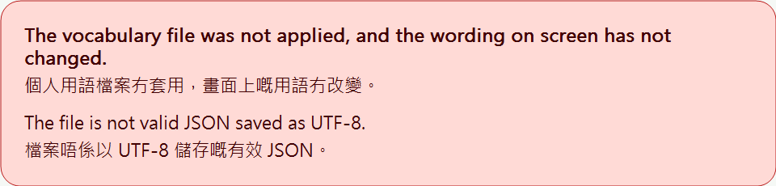

# 個人詞彙

Preferences > Appearance > Personal vocabulary 載入本機版本 1 JSON 檔。同一控制項亦可替換已載入檔案。Clear personal vocabulary 唔使重啟就恢復原有文字。無效輸入保留目前對應。

```json
{"schemaVersion": 1, "entries": {"Open": "Inspect"}}
```

## 將檔案拖落視窗

將一個 `.json` 檔拖落主視窗任何位置，就即刻套用，唔使重啟。拖放同設定入面嘅控制項行同一套檢查，設定嗰條路照用得。拖模型同 G-code 檔唔受影響：淨係啱啱好一個 `.json` 檔先會當詞彙檔讀。

- 有效嘅檔會響一次 Windows「tada」聲，喺視窗上面放大約三秒嘅慶祝畫面。標題係拖入嚟嘅檔案俾 `private vocabulary` 嘅寫法，套用嗰陣先讀；檔案冇呢個詞條就顯示「個人用語已套用」。檔案其餘內容即刻套用落介面。
- 唔合格嘅檔會響一次 Windows 錯誤聲，喺視窗底部顯示五秒通知，講明檔案犯咗邊條規。乜都唔會儲存，畫面上嘅字亦唔會變。
- 慶祝畫面同通知唔會搶焦點，亦唔會攔住輸入：撳落去會穿過去工作區。Windows 動畫效果熄咗嘅話，佢哋會直接出現同消失，冇淡入同上升嘅標題。
- 兩種結果都會經 UI Automation 讀俾讀屏軟件聽。
- 聲音跟系統音量同靜音；Windows 報告專注時段、全螢幕程式或者簡報模式時唔會出聲，但通知同讀屏照樣出。
- 文字跟目前語言模式，雙語模式兩種語言都會顯示。淨係標題嚟自檔案，記錄檔只記低有冇套用同埋犯咗第幾條規。

顯示網頁內容嘅面板（主頁、裝置頁）會自己處理拖放，拖落去嘅檔案未必去到視窗嘅拖放處理。

| 已套用 | 已拒收 |
| --- | --- |
|  |  |

截圖用嘅係虛構示範檔，唔係真嘅個人詞彙；詳情睇[截圖來源](../../screenshots/vocabulary-drop/README.md)。

## 檔案格式同限制

檔案係一個 JSON 物件，只可以有兩個欄位：`schemaVersion` 必須係整數 `1`；`entries` 係一個物件，將原本介面用語對應去替換用語。空嘅 `entries` 物件有效。

| 規則 | 限制 |
| --- | --- |
| 檔案大小 | 256 KiB（262,144 位元組）UTF-8，包括空白。UTF-8 位元組順序記號只可以喺檔案開頭。 |
| 巢狀深度 | 物件同陣列最多 8 層。版本 1 檔案用 2 層；項目下面再有巢狀內容就當係非字串值。解析器去到第 9 層就停。 |
| 鍵長度 | 1 至 160 個 Unicode 碼位。 |
| 值長度 | 1 至 1,000 個 Unicode 碼位。 |
| 項目數量 | 冇固定數目。所有有效項目都接受，所以只有檔案大小限制可以放幾多個項目。 |

長度計 Unicode 碼位，唔係 UTF-8 位元組，亦唔係 UTF-16 單位。基本多文種平面以外嘅字元（例如 emoji）只計一次，即使佢佔 4 個 UTF-8 位元組、一對 JSON 代理對跳脫序列，或者 2 個 UTF-16 單位。

載入器亦會拒絕：

- 格式錯誤嘅 JSON：空檔、語法錯誤、註解、結尾多餘內容、無效 UTF-8，或者唔成對嘅代理跳脫序列；
- 任何物件入面重複嘅鍵，比較前會先解碼跳脫序列；
- 冇 `schemaVersion`，或者佢唔係整數 `1`（`2`、`1.0` 同 `"1"` 全部拒絕）；
- 上面兩個以外嘅根欄位，或者 `entries` 唔係物件；
- 唔係字串嘅項目值；
- 鍵同值入面嘅空白文字（空，或者只有 Unicode 空白）、C0 同 C1 控制字元、DEL、U+202A 至 U+202E 同 U+2066 至 U+2069 嘅方向嵌入、覆寫同隔離字元，以及完全等於 `__proto__`、`constructor` 同 `prototype` 嘅名稱。

顯示或者儲存任何嘢之前，會先檢查成個檔案。結構問題（大小、格式錯誤嘅 JSON、深度同重複鍵）最先檢查，跟住係版本，再跟住係欄位同項目。任何一條規則唔通過，成個檔案都會拒絕：檔案入面乜都唔會套用，畫面上嘅用語維持原狀。設定控制項會講明係邊條規則唔通過，例如檔案大過 256 KiB，或者有項目嘅值超過 1,000 個字元。佢永遠唔會顯示檔名、鍵或者值。

## 顯示

只有本地化邊界登記嘅已翻譯介面文案可參與。最終共用標籤、按鈕、原生選單同 combo 彈出顯示配接器套用對應；可編輯輸入同來源模型值永不重寫。URL、路徑同格式範本保留原文。偏好設定搜尋讀取原有未換行標籤。畫布顯示配接器使用同一介面。

匹配先搵大小寫完全相同嘅來源，最長來源優先，按單字邊界，唔遞迴。搵唔到先忽略 ASCII 字母大小寫，非 ASCII 字元仍然要完全相同。替換值保留檔案原有寫法。如果同長度嘅大小寫變體指定唔同替換值，就保留原文。索引用轉成小寫嘅 ASCII 首字元篩選候選項目。可參與介面文案嘅登記表會保留每次工作階段最先翻譯嘅 50,000 個唔同字串；之後先翻譯嘅文案保留原本用語。

共用畫布文字、標題、按鈕、核取方塊、單選按鈕、提示，同雙語分頁及欄位繪製會喺顯示邊界套用用語。控制項識別碼喺載入、替換同清除之間保持穩定。明確嘅組合介面只接受已登記翻譯片段同短結構分隔符號，唔會登記未知片段或者動態參數。

`composition` 探測階段檢查已登記片段、未知輸入、模式抑制同清除。`--datadir` 唔會隔離 wxWidgets 嘅個人用語快取；探測程式用獨立程式名稱。

原有明確 `###` 識別碼保留相同雜湊。普通標籤同 `##` 標籤喺安裝呢次實作時會轉用新嘅原文衍生雜湊一次，之後載入、替換同清除都保持穩定。Studio 已停用 ImGui INI 持久化（`IniFilename = nullptr`），所以唔涉及已儲存視窗排列嘅遷移；呢項來源檢查唔等於套件互動驗證。選單移除助記符號同快捷鍵時，只會承接已登記原文或者快捷鍵之前完全相同片段嘅資格，動態名稱唔會因此獲登記。

## 儲存副本

持久化使用作業系統本機程式資料目錄下嘅 `private-display/vocabulary.json`，唔屬於同步偏好。每次替換使用唯一、獨佔建立嘅同層暫存檔，再以 Windows 原子重新命名。並行寫入者唔能重新命名對方待處理內容，清除亦永不刪除另一操作待處理檔案。唔保留所選輸入路徑。承載內容、對應值或者所選檔名都唔記錄或經網絡發送。設定檔封存排除私有快取，包括自訂資料夾包含快取嘅情況。共用標籤保留原生原文同全部原有 getter 值，只喺繪製同量度時替換。按鈕同選單模型亦保留原值。因此記錄、操作比較同排列收據繼續取得原文。

啟動時，儲存副本會用上面完全相同嘅規則檢查，通過先會使用。冇副本就顯示原本用語。副本讀取唔到、超過大小限制、喺較早而較寬鬆嘅限制下儲存，或者有其他無效情況，都唔會使用：畫面顯示原本用語，設定控制項會講明儲存咗嘅個人用語未能通過檢查，同埋係邊條規則。Clear personal vocabulary 會刪除佢。如果寫唔到私人副本，有效檔案亦唔會套用，控制項會講明。

## 驗證

檔案規則有一個唔使 wxWidgets 亦唔使 Catch2 嘅測試。喺儲存庫根目錄執行：

```sh
g++ -std=c++17 -Wall -Wextra -Werror -Isrc \
    tests/personal_vocabulary/personal_vocabulary_schema_test.cpp \
    src/slic3r/GUI/PersonalVocabularySchema.cpp -o personal_vocabulary_schema_test
./personal_vocabulary_schema_test
```

佢會喺啱啱好到限制同超出一個嘅位置檢查每個限制：以位元組計嘅檔案大小、巢狀深度，以及用 ASCII、2、3、4 位元組字元同代理對跳脫序列寫成嘅鍵同值長度。佢亦會接受有 2,049、5,000 同 20,000 個項目嘅檔案，逐條測試上面嘅拒絕規則，並確認被拒絕嘅檔案唔會改變之前嘅結果。CMake 會建置做 `personal_vocabulary_schema_test`。`ui-md3/tests` 入面嘅 `personal-vocabulary-limits` 源碼合約，會喺載入器、佢嘅測試或者呢篇文章再出現固定項目數量時失敗。

喺已設定託管 Windows 建置，建立 `personal_vocabulary_tests`、`personal_vocabulary_schema_test` 同 `personal_vocabulary_probe`，再依次執行測試同探測階段：`load-first`、`restore-first`、`invalid`、`replace`、`restore-second`、`clear`、`restore-empty`、`large`、`restore-large`、`stale-cache`、`restore-stale`、`corrupt-cache`、`restore-corrupt`、`clear`、`restore-empty`。每次探測都必須係新程序。探測只喺隔離程式資料命名空間使用合成中性文字；因為冇 School mode 記錄，佢會關閉 School mode 抑制；只輸出通過／失敗。亦須以獨立程序同時執行 `race-a` 同 `race-b`，等兩者完成，再執行 `verify-race` 同 `clear`。

呢啲測試同全部探測階段（包括並行寫入者）亦可以喺 Linux 用 wxWidgets 3.2 建置同通過。嗰次執行唔係 Windows 證據。

原生 UI 仍須託管互動證據，涵蓋載入、套用文字、重啟、替換、清除同無效輸入，以及匯出／記錄保留原文。測試正常／最低尺寸、英文／粵語／雙語、淺深色同 100/125/150/200% 比例。擁有者私有 JSON 唔可以複製到公開託管輸入、記錄或者擷取；其私有端對端驗證獨立進行，喺嗰個環境仍不可用。源碼覆蓋唔聲稱全部自訂繪製表面已驗證。

`personal_vocabulary_native_contract` 源碼檢查拒絕將對應文字寫入原生標籤儲存，並測試已審查錯誤 setter 變異。唔可以取代原生互動：載入合成對應後，驗證 `Label::GetLabel()`、`GetLabelText()` 同 `GetUnwrappedLabel()` 喺繪製、替換同清除前後保留原值。喺託管程式檢查校準標題記錄、噴嘴架操作比較同排列收據標籤，與原值一致。

## 獨立設定檔嘅用詞儲存

一般設定檔保留原有本機用詞快取。使用另一個 `--datadir` 或可攜設定檔時，程式會先綁定該資料夾嘅 `private-display`，先至載入用詞。空白、損壞或者無法寫入嘅快取都唔會改讀一般設定檔，亦唔會自動複製或搬移舊快取。明確指定嘅路徑如果等同預設資料夾，就保留原有快取。

匯出同快照會排除保留嘅快取資料夾，包括未啟用設定檔。匯入備份會拒絕含有保留快取項目嘅壓縮檔；個人用詞需要另外透過本機上載或拖放載入。

`node tests/personal_vocabulary/cache_isolation.test.mjs` 用中性暫存資料測試正式快取選擇、初始化同儲存函式，解析同重繪使用替身。`--mutant=shared-cache` 必須失敗。呢啲證據唔代表已驗證完整介面或者真正 JSON 解析器。